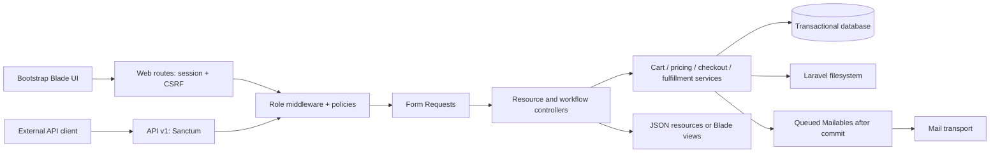
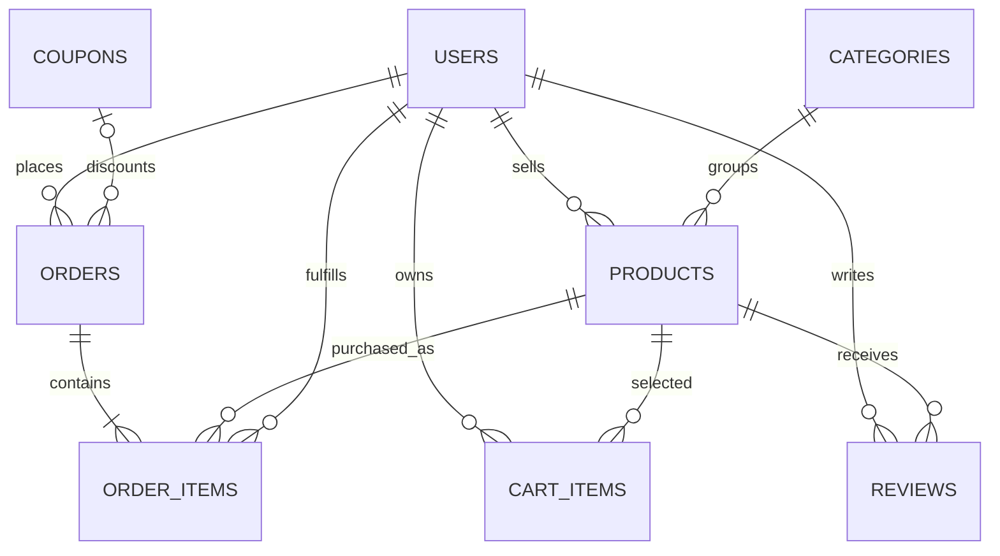

# E-Commerce architecture

## Scope

Commerce Desk supports a marketplace catalog and payment-due-on-delivery orders. It implements the requested Admin, Vendor, and Customer roles, five management modules, product/avatar validation and storage, session/database carts, Sanctum APIs, coupons, queued transactional mail, reviews, and HTML/PDF invoices.

It does not implement card charging, vendor payouts, shipping carrier integration, returns/refunds, tax jurisdiction discovery, or email verification/password recovery. Those are separate product requirements rather than simulated integrations.

## Request flow and boundaries

| Layer | Responsibility | Main files |
| --- | --- | --- |
| Routes | URI/method mapping, rate limits, authentication and role middleware | routes/web.php, routes/api.php |
| Middleware | Allowed roles; immediate denial for inactive or deleted users | EnsureRole, EnsureActive |
| Form Requests | Input shape, field validation, coarse operation authorization | app/Http/Requests |
| Policies | Ownership and per-record permissions | app/Policies |
| Controllers | Coordinate validated requests, services, and responses | app/Http/Controllers |
| Services | Transactions, stock, money, coupons, fulfillment, filesystem operations | app/Services |
| Models | Fillable boundaries, casts, relationships, visibility scopes | app/Models |
| Resources | Explicit public/API serialization, role-dependent order data | ProductResource, CartResource, OrderResource |
| Mailables | Retryable welcome, confirmation, and stock alerts | app/Mail |
| Views/assets | Bootstrap 5 UI, escaped presentation, PDF-safe invoice partial | resources/views, resources/css, resources/js |

The management controller deliberately shares the mechanics of four allowlisted CRUD modules. Each module uses a distinct model, Form Request, and policy. Orders use their own controller/service because order creation and status changes have stock and financial invariants. There is no generic order-write endpoint.

The view composer supplies settings to the settings screen and invoice partial. Views do not query settings directly. Named routes generate application links. Queries returning paginated records use a deterministic newest-first order with an ID tie-breaker.

## Schema and relationships

| Table | Important columns and constraints |
| --- | --- |
| users | Unique email; role string; active boolean; hashed password; avatar path; soft deletes |
| categories | Name, description, unique slug; product foreign keys restrict category deletion |
| products | Name, description, decimal price, stock, category_id, vendor_id, active/draft status, image path, soft deletes |
| orders | user_id, buyer/address snapshots, integer-cent totals, coupon_id, status, cancellation timestamp, UUID key/request hash, soft deletes |
| order_items | order/product/vendor foreign keys, product-name and price snapshots, quantity, per-line fulfillment, inventory_reserved |
| coupons | Unique normalized code, percent/fixed type, value, minimum_cents, active flag, start/end dates, usage_limit/uses, soft deletes |
| cart_items | user_id/product_id, quantity; unique user/product pair; cascades for physical parent deletion |
| reviews | user_id/product_id, rating/body; one review per customer/product |
| settings | Unique key and stored value |
| personal_access_tokens | Sanctum's hashed token storage, abilities, expiration |
| sessions | Database-backed browser sessions |
| jobs / failed_jobs | Queue persistence and failed-job diagnostics |

User–product cart membership also exposes a many-to-many relationship through cart_items with quantity on the pivot. Users, products, and orders have one-to-many domain relationships. Foreign keys prevent deleting referenced commercial records physically.

The earlier customers and suppliers tables remain to preserve the existing database. New customer identities are users; customer contact details for orders are immutable header snapshots. Legacy order columns remain nullable for historical compatibility, and new checkout uses order_items.

## Authorization

| Operation | Admin | Vendor | Customer |
| --- | --- | --- | --- |
| Public catalog | Yes | Yes | Yes, and guests |
| Users/categories/coupons/settings management | Yes | No | No |
| Product management | All | Owned products | No |
| Order list/detail | All | Orders containing owned line items | Owned orders |
| Fulfill an order line | Any line | Owned line only | No |
| Cancel before any item ships | Yes | No | Owned order only |
| Delete/archive an order | Cancelled orders | No | No |
| Invoice/PDF/confirmation resend | All | No | Owned order only |
| Checkout/cart API | No | No | Yes |
| Review a product | Delete moderation only | No | After a delivered purchase |

Guest web carts are supported, but checkout requires an authenticated active customer. Registration ignores any supplied role. Role/active fields are intentionally excluded from normal User mass assignment; the admin service sets them explicitly after validation.

Ownership is checked before loading protected views and again under the product lock before writes. A vendor cannot supply vendor_id to create or transfer inventory. Order lines retain the vendor at purchase time, so later product reassignment does not transfer existing fulfillment responsibilities.

No client-supplied customer/user ID determines cart or order ownership. Vendor order responses omit other vendors' items, order-wide totals, and buyer email. Vendors see the recipient name and delivery address needed for fulfillment.

Changing a user's role, password, email, or active status revokes their API tokens. Existing requests reload the user and the active middleware denies disabled accounts. The last active administrator cannot be disabled/demoted/deleted, and admins cannot delete their own account.

## Cart lifecycle

- Guests store a bounded product-ID/quantity map in the session.
- Authenticated customers store cart rows in the database, shared across web and API clients.
- Login merges a guest cart into the persistent cart, clamps quantities to available stock, limits the cart to 100 products, and clears the guest map.
- Setting quantity zero removes a line.
- API PUT cart replaces the complete cart only after every line validates; invalid input leaves the original cart unchanged.
- Authenticated writes lock the customer row, serializing concurrent cart modifications and checkout for that customer.
- Cart prices are always current product prices. A cart is not a stock reservation or price guarantee.
- Archived products remain visible as unavailable cart lines so the buyer can remove them.

## Checkout transaction

1. Lock and reload the buyer. Verify active customer status.
2. Look up the unique user/UUID checkout key, including archived orders.
3. Return the existing order for an identical retry; return 409 when the address/coupon differs or the original order was archived.
4. Read the buyer's persistent cart.
5. Lock an applied coupon and validate availability.
6. Lock product rows in ascending ID order.
7. Validate active vendor/product status and sufficient stock for every item.
8. Compute subtotal, discount, tax, and grand total in integer cents.
9. Create the order header and product/vendor/name/price snapshots.
10. Decrement stock and create reserved order lines.
11. Increment coupon usage and clear the cart.
12. Queue confirmation and threshold-crossing stock alerts after commit.

The database unique key is (user_id, idempotency_key). A checkout UUID identifies a purchase attempt, not a reusable cart. Prices, totals, stock, recipient identity, and vendor ownership are never accepted from the client.

All writes roll back if an item or coupon is invalid. Transactions retry deadlocks up to three attempts. MySQL/PostgreSQL row locks are required to validate overselling protection under real concurrency; the local SQLite suite verifies arithmetic and rollback rather than row-lock semantics.

## Money, coupons, and taxes

Product price is stored as decimal text. Money converts that text to cents without floating-point arithmetic. Order and line calculations use integers; formatting to decimal text happens at the presentation boundary.

Percent discounts use floor(subtotal × percent / 100); fixed coupons store integer cents. Both are capped at the subtotal. Tax is calculated on the discounted subtotal using basis points and rounds half-up to the nearest cent. A 1200-basis-point setting means 12%.

The default tax rate is zero. An administrator sets one store-wide rate; this is not a geographic tax engine. Coupons validate active status, start/expiry times, minimum purchase, and remaining global usage. Cancellation releases one coupon use. Per-customer coupon limits are not part of this model.

## Fulfillment, cancellation, and archival

Each line follows pending → processing → shipped → delivered. A vendor supplies its own item_id; an ID belonging to another vendor/order cannot be processed. Transitions cannot skip steps or reverse fulfillment.

The header is delivered only when every item is delivered; shipped only when every item is shipped/delivered; otherwise it becomes processing when any item progresses. This makes mixed-vendor progress visible without allowing one vendor to mark the whole order delivered.

Cancellation locks the order and is rejected if any line has shipped/delivered. Reserved quantities return to stock once, line reservation flags are cleared, coupon usage is released, and cancelled_at is set. Repeating cancellation has no further side effects.

Deletion is a soft archive available only for cancelled orders. Order UUIDs remain reserved even after archival. Product/user/coupon soft deletion preserves references. Receipts use order snapshots rather than current product names/prices or current buyer contact details.

## Upload storage

Image validation checks actual MIME content, permitted image formats, dimensions, and a 2 MB size limit. Laravel generates random hashed filenames. Public storage is the tested default. The public web server must serve the upload tree as static files without allowing script execution.

Replacement stores the new file first, saves its path, removes the prior file after success, and deletes the newly stored file if persistence fails. Soft deletion retains files. Periodic orphan-file cleanup may be added after defining a retention policy; filesystem and database operations are not a single distributed transaction.

The image service uses the configured disk for storage, deletion, and URLs. S3 requires its adapter and access/URL configuration. Validation is implemented; automatic thumbnail generation is not required by the selected validation alternative.

## API contract

All routes are under /api/v1. JSON resources wrap data; paginated catalog/order responses include links and meta.

| Method | Path | Authentication and behavior |
| --- | --- | --- |
| POST | /tokens | Credentials; returns a seven-day token |
| DELETE | /tokens/current | Sanctum; revoke current token |
| GET | /products | Public catalog; search/category/page/per_page |
| GET | /products/{id} | Public available product |
| GET | /products/{id}/inventory | Sanctum; stock availability |
| GET | /cart | Customer; lines and current totals |
| PUT | /cart | Customer; replace items array |
| POST | /cart/items | Customer; product_id and quantity, zero removes |
| GET | /orders | Current user's permitted orders |
| POST | /orders | Customer checkout |
| GET | /orders/{id} | Ownership policy |
| PATCH | /orders/{id} | Admin/vendor; fulfillment status and line ID |
| POST | /orders/{id}/cancel | Buyer/admin cancellation |

Use Authorization: Bearer TOKEN and Accept: application/json. Tokens have the commerce ability and cannot bypass role/policy checks. API routes use the stateless api middleware group; browser routes keep session/CSRF protections. API credentials and protected operations are rate limited.

HTTP statuses: 200 read/update, 201 token/checkout, 204 revocation, 401 unauthenticated, 403 role/ownership denial, 404 missing/invalid line, 409 conflicting checkout key, 422 validation/business rule errors, 429 rate limit. Error messages render as JSON for API paths even without an Accept header.

## Mail and operations

WelcomeMail, OrderConfirmation, and LowStockAlert implement ShouldQueue and dispatch after commit. Mail jobs have a 60-second timeout, three attempts, and progressive backoff. Configure queue reservation timeout longer than execution timeout and supervise workers. Provider acceptance and recipient delivery are different events; production mail needs verified sender/DNS configuration and a delivery test.

Low-stock alerts fire when a sale moves stock from above the configured threshold to the threshold or below. These are sale alerts rather than a recurring inventory scan. Retries or provider behavior may produce duplicate emails: delivery is at least once, not exactly once. After-commit dispatch also has a database-commit/enqueue crash window; a transactional outbox would be needed if guaranteed notification delivery across that window is a requirement.

A scheduled Sanctum command prunes tokens expired for more than 24 hours. Expiration is enforced at authentication independently of pruning. Configure one scheduler or shared-cache coordination across multiple nodes.

## Existing-data migration

The schema extension is additive. Earlier Staff accounts become Vendors. Existing category slugs are backfilled with name/id values. Existing orders get buyer and monetary snapshots and a corresponding order-item row.

Legacy lines are marked inventory_reserved=false because the earlier application did not reserve inventory; cancelling one must not add stock that was never subtracted. Legacy products have nullable vendor_id until an admin assigns ownership. They are excluded from the storefront until assigned to an active vendor.

Schema/backfill migrations are suitable for this small existing application. For a large deployed dataset, stage the backfill into resumable batches and measure lock times. Rollback drops new columns and cannot reverse role/data transformations safely; prefer backups and forward migrations for production.

## Verification and limits

The Pest feature suites exercise management flows, ownership denial, input validation, guest-cart merging, API synchronization, exact cent arithmetic, invalid-stock rollback, coupon constraints, checkout retries, fulfillment isolation, cancellation, uploads, review eligibility, token access, settings, invoices, and actual PDF output. Mail and storage are faked where appropriate; no external email is sent by the suite.

Production release verification must additionally exercise the chosen MySQL/PostgreSQL engine with competing checkouts, real SMTP and queue workers, HTTPS/cookie settings, upload serving, browser accessibility/layout, and expected workload size. No browser automation or infrastructure load test was run in this workspace.

This code implements payment due on delivery. Add an explicit payment state machine and verified provider webhooks before accepting online payments, refunds, or vendor payouts. Monetary/tax/fulfillment rules here are intentionally explicit so those integrations have clear boundaries.
